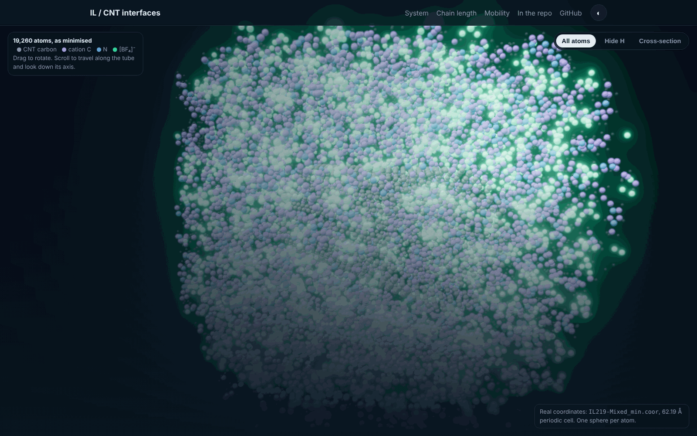
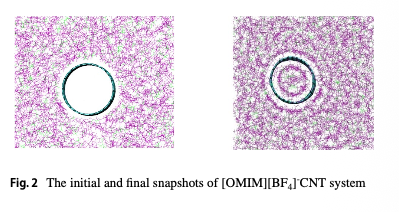
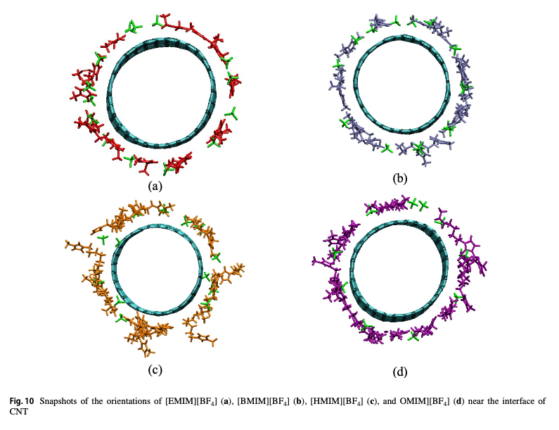
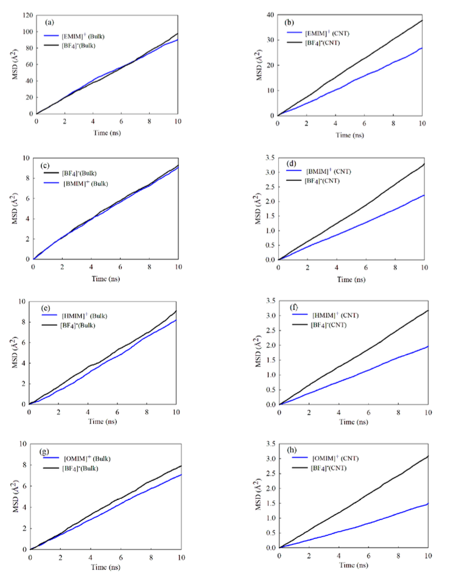
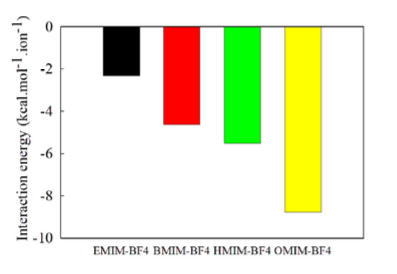

<p align="center"><a href="https://soham-cheme.github.io/MD-IL-CNT-Interfacial-Interactions/"></a></p>

<div align="center">

### [▶ View the live page](https://soham-cheme.github.io/MD-IL-CNT-Interfacial-Interactions/) · rotate the 19,260-atom minimised box, look down the tube, step through the four cations

[](https://doi.org/10.1007/s11224-024-02323-3)
[](https://doi.org/10.1007/s11224-024-02323-3)
[](https://www.ks.uiuc.edu/Research/namd/)
[](#simulation-protocol)
[](docs/CLAIMS.md)

Rima Biswas · Prateek Banerjee · **Soham Sudesh Kavathekar** (co-author)
Process Simulation Research Group, School of Chemical Engineering, Vellore Institute of Technology

</div>

---

## The one-sentence version

**All-atom molecular dynamics of four imidazolium ionic liquids confined in a (15,15) carbon nanotube shows that the cation's alkyl-chain length sets how the ions orient, how strongly they bind to the tube wall and how fast they move: the longest chain binds hardest (−8.75 kcal mol⁻¹ per ion for [OMIM]⁺, with 1.01 hydrogen bonds per cation inside the tube) while the shortest chain, [EMIM]⁺, moves fastest.**

Carbon nanotubes bundle in most solvents through van der Waals attraction. Ionic liquids disperse them without chemical modification, but the interfacial mechanism was not resolved at the molecular level. The study resolves it for the [BF₄]⁻ series and connects it to the properties that matter for CNT-based electrolytes and supercapacitors: interfacial binding, ion mobility and hydrogen bonding.

**What this repository contains, exactly:** the CNT and the four ion-pair structures, a complete NAMD minimisation of the [BMIM][BF₄] + CNT system (input, 10,000-step energy log, trajectory, final coordinates, 19,260 atoms) and the figures prepared for the article. The production trajectories behind the published numbers are not included, and the structure (`.psf`) and parameter files the NAMD input references are not either, so the run cannot be re-executed from the repository as is. The claim-by-claim audit, separating what the files verify from what is quoted from the article, is in [`docs/CLAIMS.md`](docs/CLAIMS.md).

<p align="center"></p>

---

## Systems

Four ionic liquids sharing the [BF₄]⁻ anion, differing only in cation alkyl-chain length, each with a (15,15) armchair single-walled CNT (50 Å long, 20 Å in diameter, 1,260 carbon atoms) and 600 ion pairs in a periodic box (62.19 Å cube in the included run).

| Ionic liquid | Cation | Chain | Cation atoms |
|---|---|---|---|
| [EMIM][BF₄] | 1-ethyl-3-methylimidazolium | C2 | 19 |
| [BMIM][BF₄] | 1-butyl-3-methylimidazolium | C4 | 25 |
| [HMIM][BF₄] | 1-hexyl-3-methylimidazolium | C6 | 31 |
| [OMIM][BF₄] | 1-octyl-3-methylimidazolium | C8 | 37 |

## Simulation protocol

NAMD 2.14, OPLS-AA force field with CL&P parameters for the ions, CHELPG partial charges, particle-mesh Ewald electrostatics with a 12 Å cutoff, 1 fs time step, frames every 1 ps.

| Stage | Ensemble | Length | Purpose |
|---|---|---|---|
| Minimisation | | 10,000 conjugate-gradient steps (included: `IL219-Mixed_min.*`) | relax the Packmol configuration: total energy 2,105,687 → −47,319 kcal/mol |
| Heating | NVT | 100 ps, five annealing cycles 300 to 650 K | equilibrate the ion distribution |
| Equilibration | NPT, 300 K, 1 atm | 5 ns + 5 ns | confirm nanotube filling |
| Production | NPT, 300 K, 1 atm | 20 ns per system | trajectory analysis |

Tools: [NAMD](https://www.ks.uiuc.edu/Research/namd/) for dynamics, [VMD](https://www.ks.uiuc.edu/Research/vmd/) for analysis, visualisation and CNT coordinates, [Packmol](http://leandro.iqm.unicamp.br/m3g/packmol/home.shtml) for initial packing.

---

## Results

Values in this section are those reported in the article (*Structural Chemistry* 35, 1743–1753, 2024). The −8.75 kcal mol⁻¹ ion⁻¹ binding energy and the 1.01 hydrogen bonds per cation for [OMIM][BF₄] appear in the public abstract; the remaining values are from the full text and the figures prepared for it, which are in this repository. None of them can be recomputed from the files here, because the production trajectories are not included.

### Orientation at the wall

Cations adopt two orientations, parallel and perpendicular to the tube surface, for every chain length; the parallel one is the more stable through π-π stacking with the wall. Short-chain cations ([EMIM]⁺, [BMIM]⁺) park their imidazolium ring against the sidewall; long-chain cations ([HMIM]⁺, [OMIM]⁺) lay the alkyl tail along the wall and push the ring toward the tube axis.

<p align="center"></p>

### Confinement slows the ions three- to four-fold

| System | D<sub>cation</sub>, bulk | D<sub>cation</sub>, in CNT | Reduction |
|---|---|---|---|
| [EMIM][BF₄] | 1.50 × 10⁻¹⁰ m² s⁻¹ | 0.44 × 10⁻¹⁰ m² s⁻¹ | ~3× |
| [BMIM][BF₄] | 1.47 × 10⁻¹² m² s⁻¹ | 0.36 × 10⁻¹² m² s⁻¹ | ~4× |
| [HMIM][BF₄] | 1.41 × 10⁻¹² m² s⁻¹ | 0.33 × 10⁻¹² m² s⁻¹ | ~4× |
| [OMIM][BF₄] | 1.20 × 10⁻¹² m² s⁻¹ | 0.28 × 10⁻¹² m² s⁻¹ | ~4× |

<p align="center"></p>

### Hydrogen bonding and interfacial binding both grow with chain length

| System | H-bonds per cation in CNT | Interaction energy with CNT (kcal mol⁻¹ ion⁻¹) |
|---|---|---|
| [EMIM][BF₄] | 0.78 | ≈ −1.5 |
| [BMIM][BF₄] | 0.81 | ≈ −4.0 |
| [HMIM][BF₄] | 0.89 | ≈ −6.5 |
| [OMIM][BF₄] | 1.01 | −8.75 |

Longer chains stack their tails parallel to the graphene-like wall, strengthening dispersion binding, and crowd the rings toward the axis where anion contact, and therefore hydrogen bonding, is more likely. Values marked ≈ are read from the interaction-energy figure.

<p align="center"></p>

### Conductivity

[EMIM][BF₄] gives the highest confined ionic conductivity of the series, 0.005 S m⁻¹, from the combination of the fastest self-diffusion and the fewest hydrogen bonds. Binding strength and mobility pull in opposite directions along the series, which is the design trade-off for CNT–IL electrolytes.

---

## What the repository verifies on its own

| Quantity | Value | File |
|---|---|---|
| Nanotube | 1,260 C atoms, 50.3 Å long, 20.3 Å mean diameter | `CNT.pdb` |
| Minimised [BMIM][BF₄] system | 19,260 atoms: 600 cations (25 atoms each) + 600 [BF₄]⁻ + the tube; 62.19 Å periodic cell | `IL219-Mixed_min.coor`, `.xsc` |
| Minimisation | 10,000 steps; total energy 2,105,687 → −47,319 kcal/mol; NAMD 2.14 CUDA, 1 fs, PME, 12 Å cutoff | `IL219-Mixed_min.log`, `.namd` |
| Ions inside the tube after minimisation | 659 atoms within the tube radius | `docs/build_assets.py` |

## How to run

```bash
git clone https://github.com/Soham-ChemE/MD-IL-CNT-Interfacial-Interactions.git
cd MD-IL-CNT-Interfacial-Interactions
pip install -r requirements.txt
./reproduce.sh                       # rebuilds docs/assets (page data, figures, social preview) from the NAMD files and prints the table above
vmd CNT.pdb IL219-Mixed_min.dcd      # inspect the minimisation trajectory
```

Re-running the NAMD minimisation itself needs `IL219-Mixed.psf` and the parameter file referenced in `IL219-Mixed_min.namd`, which are not in the repository. The live page (`docs/index.html`) opens from `file://` with no build step.

## Citation

```bibtex
@article{biswas2024il_cnt,
  author  = {Biswas, Rima and Banerjee, Prateek and Kavathekar, Soham Sudesh},
  title   = {Molecular dynamics studies on interfacial interactions between imidazolium-based ionic liquids and carbon nanotubes},
  journal = {Structural Chemistry},
  volume  = {35},
  pages   = {1743--1753},
  year    = {2024},
  doi     = {10.1007/s11224-024-02323-3}
}
```

## Contact

Soham Kavathekar · MS Chemical & Biomolecular Engineering, University of Pennsylvania · [stg3719@seas.upenn.edu](mailto:stg3719@seas.upenn.edu) · [linkedin.com/in/soham-kavathekar-cheme](https://www.linkedin.com/in/soham-kavathekar-cheme)

MIT License for the code and page; the article's figures are reproduced here by their authors.
